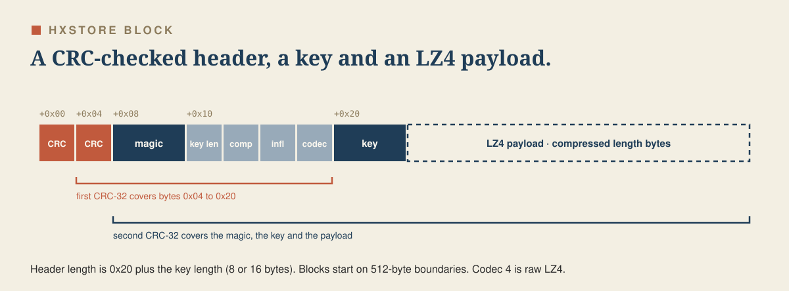

# HxStore.hxd format notes

New Outlook keeps its local cache in
`~/Library/Group Containers/UBF8T346G9.Office/Outlook/Outlook 15 Profiles/Main Profile/HxStore.hxd`.
This page describes the format as decoded from one real store (New Outlook for Mac 16.113.4, about 27 MB; the layout changes in 16.114.3 are in [their own section](#outlook-161143-layout-change)) and what the `hxstore` importer does with it. It contains structure only. No content from the sample appears here, in the code or in the tests.

Confidence labels:

- **V (verified):** a structural rule held on every object, or an independent field agreed (for example a CRC, or a folder id that matches another object).
- **C (correlated):** a strong statistical match on this sample.
- **I (inferred):** plausible, not confirmed.

Offsets are hexadecimal. "+x" offsets in the object sections count from the first byte of the object envelope.

## Status

The importer reads messages, recipients, folders, accounts, attachments (metadata plus a path to the cached file) and calendar events. On the sample it decoded 948 message objects (943 after Message-ID dedup), 731 attachment records and 197 events, with no decode errors and in about 5 seconds. It works on live copies taken while Outlook runs, and it stops with an error when a class layout differs from the table below.

| Field | Fill rate on the sample | Confidence |
|---|---|---|
| Subject, Message-ID, received date, folder, account | 99 to 100% | V |
| Sender address | 96% | V |
| At least one To recipient | 89% | C |
| Full HTML body in the store | 85%; 3% more point to an `EFMData` file; the rest have only a preview | V |
| Has-attachment flag | set where attachment objects exist | C |
| Event UID, start, end, timezone, calendar | 100% of non-stub events | V |
| Event attendees | parsed for every event that has a list | V |
| Recurrence rule | every pattern Outlook offers, from 14 synthetic and 3 real series | V |

## Container

### File header

| Offset | Value | Meaning | Confidence |
|---|---|---|---|
| 0x00 | `Nostromo` | magic | same | V |
| 0x08 | `i` (0x69) | format version. The importer refuses other versions. | same | V |
| 0x38 | 0x1000 | page size | same | V |
| 0x50 | 0xdeadbeef | guard, repeated around 0x9c | same | V |
| 0x28, 0x2c, 0x30, 0x40 | length, counter, CRC-32, offset | descriptor of a region at 0x3000. The CRC-32 at 0x30 matches that region. | same | V |
| 0x68 to 0x78 | same shape | a second descriptor whose CRC does not match: probably a stale alternate slot | same | I |
| 0x10 | u64 | called "live data size" elsewhere. It is not a bound: valid blocks exist past it. | same | V (refuted as bound) |

### Blocks

Blocks start on 512-byte boundaries. Find them by scanning for the 8-byte magic `05 6a 70 3b 64 45 02 5d` and stepping back 8 bytes.

| Offset | Type | Field |
|---|---|---|
| +0x00 | u32 | CRC-32 of block[0x04:0x20] |
| +0x04 | u32 | CRC-32 of block[0x08 : header length + compressed length], so it covers the magic, the key and the payload |
| +0x08 | 8 bytes | magic |
| +0x10 | u32 | key length: 8 (u64 object id) or 16 (GUID-like key). Header length is 0x20 + key length. |
| +0x14 | u32 | compressed length |
| +0x18 | u32 | inflated length |
| +0x1c | u32 | codec, always 4 = LZ4 |
| +0x20 | key | 8 or 16 bytes |

All V. The payload is a raw LZ4 block without a frame. A strict decoder (exact output length, all input consumed) decoded every block whose CRCs passed. Four of 5,531 blocks failed the header CRC (torn or stale) and are skipped.

This corrects the public spec, which assumes a fixed 40-byte header. That assumption breaks every 16-byte-key block.

**Cross-check with hxprobe (V).** ukd1's `hxprobe` (MIT, reviewed before running: no network access, no build script, read-only memory map) was built and run on a copy of the sample. It finds the same 5,531 blocks. It rejects 18, while we reject 4. The 4 that fail the header CRC fail in both tools. The extra 14 are exactly the 16-byte-key blocks: hxprobe always starts the payload at +0x28, so its payload CRC range ends 8 bytes short. Neither tool had an LZ4 failure. hxprobe reports 2,433 "messages" because it cuts records between UTF-16 `IPM.Note` strings and merges them by sender and time. That counts revisions and non-message hits. Our 948 come from typed 0xc9 objects (see list items below).

Most objects exist in several copies (older versions in other blocks). The importer takes the copy with the highest change stamp and fills missing fields from older copies.

## Objects

Inside an inflated payload each object is preceded by a u32 length and often followed by the trailer `00 00 00 00 00 01 00 00 00 00 01`.

| Offset | Type | Field | Confidence |
|---|---|---|---|
| +0x00 | u16 | 5 | V |
| +0x02 | u16 | fixed-region size (fs). Fixed per class and per Outlook build, so it works as a layout version check. | V |
| +0x04 | u32 | total object length | V |
| +0x0a | u16 | class | V |
| +0x14 | u64 | object id | V |
| +0x1c | u32 | parent property (which collection of the parent this object belongs to) | V |
| +0x20 | u64 | parent id | V |
| +0x28, +0x30 | u64 | id and parent id again | V |
| +0x68 | u32 | lead: the string area starts at fs + lead. "Area one" is [fs, fs + lead). | V |
| +0x70 | u64 | change stamp, higher means newer | V |

**Field descriptors** are pairs of u32 offset and u32 byte length. If bit 31 of the length is set, the offset is relative to the string area. Otherwise it is relative to area one. Length 0 means absent. Text is UTF-16LE including a 2-byte NUL. HTML bodies are UTF-8 without a NUL.

**Typed references** are 46-byte records: u16 class, padding, then the referenced u64 id at +10. The object header uses the same shape for its self-reference.

**Timestamps** are .NET ticks in UTC: `unix = (ticks - 621355968000000000) / 10**7`. The value 0x2BCA2875F4373FFF (DateTime.MaxValue) means unset.

### Classes used

| Class | fs on 16.113.4 | fs on 16.114.3 | fs on 16.115 | Meaning |
|---|---|---|---|---|
| 0x49 | 0x1992 | 0x19d0 | 0x1a12 | account (settings, primary SMTP address) |
| 0x4a | 0x6ca | same | same | mail account |
| 0x4d | 0x4c2 | 0x4d8 | same | folder |
| 0x55 | 0x15e | same | same | recipient |
| 0x68 | n/a | n/a | n/a | calendar |
| 0x6b | 0x455 | same | 0x459 | calendar event |
| 0x6c | 0x348 | same | same | event detail (body, join URL) |
| 0xc9 | 0x60f | same | same | message |
| 0xca | 0x740 | 0x74e | 0x752 | message body |
| 0xf7 | 0xc5 | same | same | file reference |
| 0x16a | 0x318 | same | 0x31e | attachment |
| 0x4f | 0x430 | not checked | not checked | per-folder message list item (not imported) |

**Layout guard.** Field offsets are known only for the sizes in this table (`EXPECTED_FS` in `importers/hxformat.py`). Both builds are accepted, per object: each object is read with the offsets of its own size (`FIELDS`), so copies written before and after an update can sit in one store. If any object of a listed class has a different fs, the import stops with an error that names the class, the found size and the expected size. Nothing is imported from that store, and the sync notification fires. The importer does not guess offsets for a changed layout. After an Outlook update triggers this, the offsets for the new size must be checked on a fresh snapshot.

**List items (class 0x4f).** The sample has 644 list items and 948 message objects. 641 of the list items reference an existing 0xc9 message through typed references at +0x11a (id at +0x124) and further ones at +0x12e, +0x14a and +0x15e. (C) So list items do not reveal messages whose full object is missing. On this sample, the 0xc9 objects are the complete message set.

## Live copies (scheduled sync)

The scheduled sync cannot quit Outlook, so it copies `HxStore.hxd` and `hxcore.hfl` while Outlook may be writing to them.

- Each block carries two CRC-32s. A block caught mid-write fails one of them and is skipped. Most objects exist in two or three copies in other blocks, and the importer keeps the newest copy that decoded. One torn block therefore rarely loses an object. At worst, the latest change to that object is missing until the next sync.
- A quiet store has about 0.1% failed blocks (4 of 5,531 on the sample). When more than 2% fail (and at least 5 blocks), the importer waits 2 seconds, copies again and keeps the better copy. If the second copy is also bad, the sync goes ahead and reports a warning.
- Each sync records its numbers in `sync_runs.details_json` and prints them: blocks found, ok, CRC-failed and LZ4-failed, copies taken, whether `hxcore.hfl` was copied, and distinct objects per class. New and merged messages are in the normal sync counts.
- `hxcore.hfl` is copied next to the store copy but not parsed: it is a diagnostic log (see below).

## Cache coverage

`new-outlook coverage` counts messages per account and folder, per week (last 12) and per day (last 30). It works on the archive or directly on a copy of `HxStore.hxd` (`--hxstore PATH`), and prints counts only.

What the sample shows (aggregates only):

- Dense coverage spans about the last 8 to 9 weeks before the snapshot, in every main folder at once (Archive, Sent Items, Deleted Items). Earlier weeks hold only scattered messages, back about a year in Archive. The scattered older ones fit the "filled on demand" behaviour: opened, searched or scrolled to. The cache window here is shorter than the 180 days often quoted.
- In the last 30 days, the main archive folder has mail on every weekday, up to the day of the snapshot. Inbox is small because mail is archived out of it, so its weekday gaps do not mean much.
- This fits new mail landing in the cache as it arrives, but does not prove it: messages could also have been opened. The "new mail, not clicked" step of the snapshot pair below settles it.

Consequence for the sync plan: every 36 hours is well inside an 8-week window. The archive keeps everything it has seen, so older messages that drop out of the cache remain searchable.

### What a search in Outlook adds (2026-11-15)

Measured on 16.115 with three before/after pairs. Counts only.

- **Scrolling search results** adds a 0xc9 message and an (empty) 0xca body object per result, without opening anything: 804 messages after scrolling one word search to its end. Each has subject, sender, dates, folder reference and Message-ID; 783 have the preview. None has an HTML body, 3 have recipient objects, none has attachment objects (155 carry only the has-attachment bit).
- **Opening results** completes them: five clicks completed 11 messages (Outlook opens the conversation), each with body and recipient objects, 10 with attachment objects. The attachment files were present for 4 of those messages and not downloaded for 6.
- **Reach.** A word search stopped after about eight months of results. A `received:` date range for two earlier months returned 557 further messages.
- **Search results are temporary.** The next search removed 534 of the first search's 804 messages from the cache again. The archive keeps what a sync saw, so a sync has to run between searches; the watcher and the `fetch_from_outlook` tool both do.
- Bodies of older mail often survive as orphan `EFMData` files. When a search brings the message header back, the importer matches it to its body file again.

## hxcore.hfl: a diagnostic log, not a journal (2026-11-15)

Looked at in more than 20 copies taken during one day on Outlook 16.115, next to the store copies of the same moments. Structure only.

- **It is append-only, then wraps.** Between two copies the newer file is the older one plus appended bytes (checked on 6 pairs; it grew from 22.6 MB to 52.4 MB in the day). At about 50 MiB it stops growing and is overwritten from the start.
- **It holds no store data.** No block magic, no object envelopes beyond chance hits, no "unset" timestamp value, and none of the synthetic subjects that were created, flagged, moved and deleted that day, in UTF-16 or UTF-8. The object ids of the test messages do not occur.
- **What it holds** are repeated trace tokens such as `SmartSync`, `HttpSocketResponse`, `ApplyStorageThreadCha…`, `Completed`, and a build string at the start: a log of sync activity. The header starts `08 00 00 00 00 00 01 00`, followed by a u64 tick time.
- **The store itself is fresh.** Every one of about 25 test actions that day (new mail, read and flag toggles, categories, moves, new and changed events) was in `HxStore.hxd` in the copy taken about a minute later. The one thing seen late was a moved occurrence, and that waited in queue objects (class 0x4008) inside the store, not in this file.

So parsing `hxcore.hfl` would not make the archive fresher, and no parser is planned. The sync still copies it next to the store copy; that copy is no longer needed.

## Messages (class 0xc9)

| Field | Encoding | Confidence |
|---|---|---|
| Stable key | 51-byte blob at descriptor +0x58c. It starts `00 09 00 2e`, and its base64url form has the shape of a Graph/REST id (`AAkALgAAAAAA…`). Unique per message on the sample. Used as the importer's source key. | V (unique); I (equals Graph ImmutableId) |
| Subject | +0x598 | V |
| Subject without Re:/Fw: prefix | +0x4ec | C |
| From name, address | +0x56c, +0x574 | V |
| Sender (name, address) | +0x440, +0x448: the `Sender` header, present when a list or a delegate sent the message on behalf of From. Equals the Sender header the legacy archive stored in 120 of 122 messages that have the pair and legacy headers; the other 2 have no Sender header. The From field equals the From header in all 120. Empty otherwise. | V |
| Internet Message-ID | +0x4cc, `<…@…>` form. Almost unique (5 duplicates in 948, for example a message in two folders). Used for dedup with the legacy archive. | V |
| In-Reply-To | +0x4bc | C |
| Message class | +0x4d4 (`IPM.Note` etc.) | V |
| Preview, up to about 255 characters | +0x518 | V |
| Date received | u64 ticks at +0x120 | C |
| Date sent | u64 ticks at +0x2d8, a few seconds before received | C |
| Folder | typed reference at +0x382 (id at +0x38c) to a 0x4d folder | V |
| Account | object parent (+0x20) is the 0x4a mail account. Its u64 at +0x44 is the 0x49 account, whose +0x156c string is the primary SMTP address. | V |
| Has attachment | bit 0x40 of byte +0x5e6 | C |
| Read | bit 0x02 of byte +0x5ea, set when read. See [Read state](#read-state-2026-11-15). | V on 16.115 and 16.114.3; I on 16.113.4 |
| In the Inbox | bit 0x80 of the same byte. Not imported. | C |
| Importance | u32 at +0x4b8: 0 low, 1 normal, 2 high | V |
| Flag status | byte +0x5cc: 0 none, 1 complete, 2 flagged | V |
| Flag dates | u64 ticks: completed +0x128, start +0x130, due +0x138 | C |
| Categories | descriptor +0x484: u32 count, then per name u8 byte length and UTF-16LE text | V |

**Recipients** are 0x55 objects whose parent is the message. The parent property says the role: 0xcc To, 0xcd Cc, 0xce Bcc, 0x19d Reply-To. Name at +0x124, address at +0x12c. (C; Bcc V, see [Bcc](#bcc-2026-11-15))

Offsets in the sections below are for 16.113.4. For the account, folder and body fields that moved in 16.114.3, see [the 16.114.3 section](#outlook-161143-layout-change).

**Bodies** are 0xca objects with the same id as the message. Descriptor +0x678 holds the UTF-8 HTML body. When the body is too large, a typed reference at +0x2b2 points to a 0xf7 file object whose +0x88 string is `~/Files/S0/<n>/EFMData/<k>.dat`. That file is gzip-compressed HTML (per teamscrawl, see below). `~` means the profile folder that holds HxStore.hxd. (V for the link, I for gzip until checked on a real file.) No plain-text body was seen.

**Folders** (0x4d): name at +0x434. A u32 at +0x47c gives the well-known type independent of language: 0x61 Inbox, 0x63 Archive, 0x64 Drafts, 0x65 Sent Items, 0x67 Deleted Items. 0x66 is the Snoozed folder (both folders of that type carry that name; C). 0x62 is unknown: three unnamed folders without messages. 0x7a is an ordinary folder, 0 appears on four. (V for the named types)

**Folder hierarchy: not found.** A folder's parent id (+0x20) is not another folder. Of 143 folders, 106 hang under one shared root object with parent property 0x2ab, 20 under a mail account (0x4a, property 0x2), 9 under a 0x48 object (0x2ac) and 8 under 0x172 objects. No u64 or typed reference in any folder's fixed region holds another folder's id, so nesting is not stored as a parent pointer in the folder object. The importer keeps folders flat, by name.

## Outlook 16.114.3 layout change

After Outlook for Mac updated to 16.114.3, three classes grew and the importer stopped with `HxStoreLayoutError`. All other classes kept their size, and every 16.114.3 object of the three classes had the new size (no 16.113.4-sized copies were left in the store). The new offsets were found on a copy taken with `new-outlook experiment start`, by matching fields against values the archive had already imported from 16.113.4 (folder names, account addresses, and message bodies imported before 9 October 2026), and against the message preview, which sits in the unchanged 0xc9 class.

| Class | fs 16.113.4 → 16.114.3 | Field | 16.113.4 | 16.114.3 | Where the bytes went | Evidence | Confidence |
|---|---|---|---|---|---|---|---|
| 0x49 account | 0x1992 → 0x19d0 (+0x3e) | primary SMTP address | +0x156c | +0x159c | +0x30 before the address, +0xe after it | Matches the archived account address. +0x15b4 holds the same string in all 91 copies, so the choice between the two does not change the result. +0x156c now holds a 16-character area-one string. | C |
| 0x4d folder | 0x4c2 → 0x4d8 (+0x16) | name | +0x434 | +0x448 | +0x14 before the name | The only string descriptor in the class. Every message's folder reference (895 of 895) resolves to a folder with a name there. 12 of the 28 names are folders the archive already had from 16.113.4; the rest belong to group mailboxes and a second account that the archive had no mail from. | V |
| 0x4d folder | | well-known type | +0x47c | +0x490 | same +0x14; the other +0x2 lie after the type | Values 0x61 to 0x67 or 0x7a there in 275 of 284 folders. The main account's Inbox, Archive, Sent Items, Deleted Items and Drafts carry their types; the other typed folders are group mailbox inboxes and a second account whose folders are named by GUID. | V |
| 0xca body | 0x740 → 0x74e (+0xe) | HTML body | +0x678 | +0x684 | +0x8 before +0x2b2, +0x4 between +0x2b2 and the body, +0x2 after it | 107 of 108 bodies imported from 16.113.4 match byte for byte. The 108th no longer has an inline body. In 243 of 250 messages newer than 9 October the body text contains the preview. | V |
| 0xca body | | link to the EFMData file | +0x2b2 | +0x2ba | +0x8 before it | All 35 references point at a 0xf7 file object whose path is under `EFMData/`. No 0xf7 reference is left at +0x2b2. | V |

The exact positions of the inserted bytes inside these ranges are not known, because no 16.113.4 copy of the store was kept. Only the fields the importer reads were placed.

**The full body at +0x67c (V, 2026-11-15).** Settled on a 16.115 copy with 716 body objects that hold HTML. +0x67c is the whole message as Outlook shows it, with quoted history; +0x684 is only what this message added (Graph calls them `body` and `uniqueBody`).

- 368 objects hold the same bytes in both. In 322 they differ, and in every one of those +0x67c is longer and a complete HTML document while +0x684 is a fragment.
- The text of +0x684 is contained in the text of +0x67c in 319 of the 322; the other 3 have the same text.
- 312 of the 322 are replies, and +0x67c has more quoted "From:" header lines in 292.
- 35 objects have only +0x67c, 26 only +0x684.
- Not done: comparing a synthetic reply side by side with Outlook's window.

The importer keeps +0x684 as the body, so search and threads are not flooded with repeated quoted text, and now falls back to +0x67c when +0x684 is empty (those 35 messages had only their preview before). Not located on 16.113.4.

Earlier note (2026-11-03), kept for the record: In 16.114.3 the 0xca descriptor just before the body (+0x67c) also holds UTF-8 HTML. It equals +0x684 in 442 objects. Where the two differ (378), +0x67c is always longer: it is a full HTML document, while +0x684 is often a fragment. In 34 messages only +0x67c contains the preview text, so for those the imported body is shorter than what Outlook shows. If the body area moved by +0xc, as +0x684 did, then +0x67c is the old +0x670, which the importer never read on 16.113.4. Probably the full body versus a trimmed one (Graph's `body` and `uniqueBody`). The importer still reads +0x684, the field it read before.

The first real sync after the change imported 266 messages dated 9 October to 3 November 2026 into Archive, Sent Items, Deleted Items and Inbox. `new-outlook doctor` reported `hxstore_layout` ok.

## Outlook 16.115 layout change (2026-11-14)

After the update to 16.115, four classes grew and the importer stopped with `HxStoreLayoutError`: 0x49 account 0x19d0 → 0x1a12, 0x6b event 0x455 → 0x459, 0xca body 0x74e → 0x752, 0x16a attachment 0x318 → 0x31e. Every object of these classes had the new size. The offsets were found on a copy taken with `new-outlook experiment start`, by trying each position the field could have moved to (0 up to the size increase) and keeping the one that matched values the archive had imported from 16.114.3 until 2026-11-12.

| Class | Field | 16.114.3 | 16.115 | Evidence | Confidence |
|---|---|---|---|---|---|
| 0x49 account | primary SMTP address | +0x159c | +0x15d4 | Both accounts match the archived addresses. The duplicate copy moved with it, +0x15b4 → +0x15ec. | C |
| 0xca body | HTML body, EFMData link | +0x684, +0x2ba | unchanged | 489 of 504 bodies the archive took from the cache are identical (11 lost their inline body, 4 changed). 43 links resolve to `EFMData` files. | V |
| 0x16a attachment | all fields read | unchanged | unchanged | Name, size and content type match the archive for 601 of 601, Content-ID 516 of 516, file reference 593 of 596. The 6 extra bytes come after +0x2b4. | V |
| 0x6b event | fields from +0x30c on | see Calendar | +0x4 | UID, subject, timezone, location, organizer, show-as, event type, my response and the attendee anchor (+0x36c → +0x370) match all 47 events matched by UID. Start, end, preview, the detail reference and the calendar id did not move. | V |
| 0x6b event | all-day flag | byte +0x43a, bit 0x08 | byte +0x43e, bit 0x10 | Agrees with the midnight-to-midnight rule for 199 of 199 events, and with the archive for 47 of 47. The +4 byte's old bit 0x08 is never set. | V |
| 0x6b event | cancelled flag | byte +0x43a, bit 0x10 | byte +0x43e, bit 0x20 | Agrees with the archive for 47 of 47, and with a cancellation prefix on the subject for 193 of 194. Only 2 cancelled events. | C |

The event strings the attendee parser steps over moved too (+0x304 → +0x308 or +0x30c, +0x3d4 → +0x3d8); both candidates for the first are listed. With them, attendee counts match the archive for all 47 events. A dry-run decode then matched the archive for every event field on all 47 events, and subjects and accounts for all 728 messages already archived apart from Re:/FW: prefixes and messages moved between folders since.

## Read state (2026-11-15)

Found on Outlook 16.115. The 0xc9 message keeps its read state in **bit 0x02 of byte +0x5ea** (`state` and `read_bit` in `FIELDS`). The bit is set when the message is read.

| Evidence | Result | Kind |
|---|---|---|
| Before/after pair: one synthetic message in the Inbox, marked read in Outlook, nothing else touched | Exactly one 0xc9 object changed. Byte +0x5ea went 0x80 → 0x82. | before/after |
| Second pair: the same message marked unread again | Byte +0x5ea went 0x82 → 0x80, and the next sync set the archive row back to unread. +0x5df stayed 0x02, so that byte is not the read state. | before/after |
| Unread count | The copy held 4 Inbox messages with the bit clear before and 3 after. Outlook showed 3 unread after. | count |
| The same message's Sent Items copy | bit set in both copies | before/after |
| 16.115 copy of 14 November, 789 messages | Sent Items: set in 198 of 198. Of the messages the legacy archive holds as read, 184 of 192 have it set. Of those it holds as unread, 2 of 31. | population |
| 16.114.3 copy of 3 November, 895 messages | Sent Items: 145 of 145. Legacy read: 427 of 435 set. Legacy unread: 4 of 75 set. Drafts: 0 of 26. | population |
| 505 messages matched by key between those two copies | The bit changed on 1, from clear to set. | stability |
| First sync with the decoder | Read state in the archive equals the cache for 758 of 758 messages. | import |

The legacy values are older than the cache, so the few disagreements are messages read or marked unread since. No other bit between +0x5dd and +0x60f separates the two legacy groups. The 0x4f list items carry no bit that mirrors it.

Class 0xc9 has the same size (0x60f) in all three builds, and every other 0xc9 offset is shared. The offset is verified on copies from 16.115 and 16.114.3. No 16.113.4 copy was kept, so for that build it is inferred.

Other bytes that changed in the same object when the message was marked read, not decoded: +0x5df went 0x01 → 0x02 (across the store: 0x00 on 429 messages, 0x02 on 355, 0x01 on 5, all five in the Inbox); several u64 tick values were filled or advanced (+0xa8, +0x170, +0x178, a run of 16 at +0x3b0 to +0x42f, +0x438); +0x594 went 0x86 → 0xa6; a u32 at +0x5c8 was filled. (I)

**Bit 0x80 of +0x5ea (C).** Set on every Inbox message and on no other (46 of 46 and 0 of 743 on 16.115). It was cleared on 44 messages that left the Inbox between the two copies. The importer does not read it: the folder reference says the same.

What the importer does:

- `messages.is_read` follows the cache on every sync. The New Outlook cache replaces the value the frozen legacy archive recorded, because the cache is the newer state. The folder is treated the same way (see [Live state](#live-state-in-the-archive-2026-11-15)).
- A message that sits in two folders with one Message-ID (mail to yourself: Inbox and Sent Items) is one row in the archive. It counts as unread while any copy is unread, since the Sent Items copy is always read.
- Drafts mostly have the bit clear, as they do in the legacy archive, so an `unread` search also returns drafts.
- A message that left the cache keeps the last state the archive saw.
- `layout-probe` checks `read_bit` against the archive when class 0xc9 changes size. Read state changes between syncs, so it will usually report the bit as ambiguous instead of proposing an offset.

## Flag, importance and categories (2026-11-15)

Found on Outlook 16.115 with three synthetic messages: one sent with high importance, one with low, one with normal. All fields are in the 0xc9 message. See [Read state](#read-state-2026-11-15) for why the offsets carry over to the other builds: verified on a 16.114.3 copy where a population exists, inferred on 16.113.4.

**Importance (V).** u32 at +0x4b8: 0 low, 1 normal, 2 high, the codes Exchange uses.

- All six copies of the three messages agree (Inbox and Sent Items copy of each): 2, 0 and 1.
- The byte is the only one in the fixed region that differs between all three messages and has few values across the store.
- 16.115 copy, 760 messages: 752 normal, 6 high, 2 low. 16.114.3 copy, 895 messages: 885 normal, 10 high. No other value.

**Flag status (V).** One byte at +0x5cc: 0 not flagged, 2 flagged, 1 complete. The three bytes after it belong to another field (constant on 733 of 760 messages), so it is read as a byte, not a u32.

| Action on one message, one before/after pair each | +0x5cc | +0x128 | +0x130 | +0x138 |
|---|---|---|---|---|
| never flagged | 0 | unset | unset | unset |
| flagged | 2 | unset | that day, 00:00 UTC | that day, 00:00 UTC |
| marked complete | 1 | that day, 00:00 UTC | unset | unset |
| flag cleared | 0 | unset | unset | unset |

In each pair only this one message object changed in these fields. No other message in the 16.115 or 16.114.3 copies was ever flagged (byte 0 and all three dates unset on every one), which fits a mailbox where flags are not used but gives no second example.

**Flag dates (C).** +0x128 is the completion date. +0x130 and +0x138 are start and due date; a plain flag sets both to the same day, so which is which rests on the Exchange order (start before due), not on a test with different dates. The importer stores due and completion and ignores start. "Unset" is DateTime.MaxValue.

Bit 0x02 of +0x5e7 was set by the first flagging and stayed set through complete and clear. Not decoded. (I)

**Categories (V).** The descriptor at +0x484 points to a list in the string area: u32 count, then per category a u8 byte length and the name in UTF-16LE without NUL. This is the shape of the attendee list in events.

- Assigning one category to one message created the list on that message and on its Sent Items twin: count 1 and the name Outlook shows. Nothing else in the fixed region of the object changed apart from change stamps.
- A second pair added a second category to the same message: count 2 and both names, in the order they were assigned, on both copies.
- No other message in three older copies has a list there. The parser accepts only bytes that fit the shape exactly. Otherwise it imports no list, counts the message in the sync notes, and keeps what the archive had.
- The two 0x4f list items of the message also carry the name. Not read.

What the importer does:

- `importance`, `flag_status`, `flag_due`, `flag_completed` and `categories_json` are new columns of `messages`. NULL means the source does not say (legacy mail). An importance or flag code outside the tables above is imported as unknown and counted in the sync notes.
- Flag status, flag dates and categories are live columns: they follow the cache on every sync, and a cleared due or completion date is cleared in the archive. Importance cannot change after sending and only fills gaps.
- For one Message-ID in two folders, flag and categories come from the received copy, like the folder.
- `layout-probe` has a check for each of these fields. Nearly all mail is normal, unflagged and uncategorised, so after a change of class 0xc9 they will mostly be placed by their neighbours or by hand.

## Meeting responses (2026-11-15)

Three synthetic invitations were sent from a second account and answered in Outlook: one accepted, one declined, one tentative.

| Answer | Event in the cache afterwards | My response (u32, +0x3e4 on 16.115) | Show as | My own attendee record |
|---|---|---|---|---|
| accepted | yes | 0 | 2 busy | 0 |
| tentative | yes | 1 | 1 tentative | 1 |
| declined | **no event object** | not observable | | |

- **0 accepted and 1 tentative are verified** for my response and, through my own attendee record, for the attendee response code.
- **Declining removes the event.** The declined invitation has no 0x6b object in the cache after the answer, and none of 215 events in the copy carries my-response code 2 (the codes present are 0, 1, 3 and 4). So code 2 cannot be seen on one's own calendar. That it means "declined" stays inferred: it is the one answer left between the verified 1 and 3. The decoder keeps the mapping, which in practice never fires.
- **Attendee code 2 (C).** It occurs on 5 attendee records, one of them in a meeting the mailbox owner organised, where another person's decline is exactly what an organiser sees. Not confirmed with a synthetic decline from a second account.
- My own attendee record equals the my-response field in 18 of 19 events where I am an attendee; the one difference is a record that still says "not responded".
- The answers also leave messages in Sent Items with the classes `IPM.Schedule.Meeting.Resp.Pos`, `.Neg` and `.Tent`, and the invitations (`IPM.Schedule.Meeting.Request`) move to Deleted Items. These are ordinary 0xc9 messages.

No decoder change was needed.

## Bcc (2026-11-15)

**Recipient kind 0xce is Bcc (V).** A Bcc recipient is a 0x55 object like To and Cc, with parent property 0xce, which continues the sequence 0xcc To, 0xcd Cc.

- Before/after pair: one synthetic message sent with one To and one Bcc address. Its Sent Items copy got two recipient objects, 0xcc and 0xce, with different addresses; the 0xcc one equals the sender, as sent. Its Inbox copy got only the 0xcc one, as a received copy must.
- That object is the only 0xce recipient among 2,289 in the copy. The copy taken before the pair and the older 16.115 and 16.114.3 copies have none (2,286, 2,359 and 3,137 recipients), which fits a mailbox where Bcc is rarely used.
- Class 0x55 has one size in all three builds.

The importer fills `bcc` from it. When the same Message-ID also has a received copy, the two merge into one archive row that keeps the Bcc list of the sent copy, in either order. Bcc is only knowable for mail you sent.

## Live state in the archive (2026-11-15)

Not a format finding, but a rule of the importer that rests on one. Read state, folder, flag and categories change in Outlook after a message was first imported, so for the `hxstore` source they are written on every sync (`LIVE_COLUMNS` in `db.py`). All other fields still keep the first value and only fill gaps.

- **Which source wins.** The cache wins over the legacy archive for these two columns. The legacy archive is a frozen copy of old Outlook, so where the two disagree the cache is the later state. The legacy importer is not a live source and never overwrites them, whatever the import order.
- **Account.** The account of a message does not change and stays as first imported. The new folder is looked up by name under that account, so a folder row never belongs to another account than its message.
- **Two folders, one Message-ID.** The cache copy of 15 November held three such messages, each a received copy plus a Sent Items copy. All copies report one state, so the result does not depend on their order: unread while any copy is unread, and the folder of the received copy (Sent Items, Drafts and Deleted Items rank after every other folder).
- **Gone from the cache.** The archive keeps the last folder and read state it saw. It cannot tell a message that was deleted from one that only aged out of the cache.

A synthetic message moved from the Inbox to Archive in Outlook showed Archive after the next sync.

Check on the real archive: before the change 226 of 758 cached messages had another folder in the archive than in the cache (189 now in Archive, 26 in Drafts, 11 in Sent Items). After one sync 3 differ, and those are the Sent Items copies of the three two-folder messages. No folder belongs to another account than its message.

## Attachments (class 0x16a)

| Field | Encoding | Confidence |
|---|---|---|
| Owning message | typed reference at +0x1a2 (message id at +0x1ac) | V |
| File name | +0x260 | V |
| Size | u64 at +0x238 | C |
| Content type | area-one descriptor +0x250 | V |
| Content-ID | +0x240 | V |
| Inline | u32 at +0x2b0 == 2. Every attachment whose `cid:` the body references has 2; none with 0 does. | C |
| Download state | u32 at +0x270: 2 present, 5 missing, 3 unknown | C |
| **File reference** | +0x288: `~/Files/S0/<n>/Attachments/0/<stem>[<k>].<ext>`. A 0xf7 file object (typed reference at +0x10a) repeats the path at +0x88. | V |

`<n>` is one constant per profile. `<k>` is a uniquifier, sometimes equal to the attachment object id. The stored file name can differ from the display name.

The importer resolves the reference against the profile folder (refusing paths that escape it) and stores `local_path` only when the file exists. Otherwise `local_path` is NULL and the tools say "open this message in Outlook to download it, then sync". Because HxStore is a live cache, the importer re-reads every message on each sync, so attachments downloaded later become available.

Files that no record references (orphans) are indexed separately. See [data-sources.md](data-sources.md#orphan-files). The scan reads `Files/S0/<n>/Attachments/**` and `Files/S0/<n>/EFMData/*.dat`, ignores `*cleanup*` folders, and strips the `[k]` uniquifier to get the display name.

The sample did not include the `Files/` folder, so the mapping from reference to real file is verified only in format, not against real files. See experiment 1.

## Calendar

**Event (class 0x6b).** The teamscrawl offsets hold on this build.

| Field | Encoding | Confidence |
|---|---|---|
| UID (global object id) | area-one descriptor +0x334, upper-case hex starting `040000008200E00074C5B7101A82E008`. Matches the UID in ICS exports, so events dedupe across sources. | V |
| Subject | +0x400 | V |
| Start, end | u64 ticks at +0x248, +0x250, UTC | V |
| Timezone | name at area-one +0x30c (Windows or IANA name), numeric id at +0x308 | V |
| All-day | byte +0x43a bit 0x08; start and end are then UTC midnights | V |
| Cancelled | byte +0x43a bit 0x10 | C |
| Online meeting | byte +0x43b bit 0x10 | V |
| Location | +0x344 | V |
| Organizer name, address | +0x374, +0x37c | V |
| Preview | +0x2bc | V |
| Show as | u32 at +0x330: 0 free, 1 tentative, 2 busy | C |
| Event type | u32 at +0x388: 0 single, 1 occurrence, 2 exception, 3 series master | C |
| My response | u32 at +0x3e0: 0 accepted (V), 1 tentative (V), 2 declined (I), 3 organizer, 4 not responded. See [Meeting responses](#meeting-responses-2026-11-15). | C |
| Attendees | after the +0x36c string: u32 count, then per attendee u8 name length, UTF-16LE name, u8 address length, UTF-16LE address, u32 optional flag, u32 response (0 accepted, 1 tentative, 2 declined, 4 none), u32 unknown | V |
| Detail | typed reference at +0xaa (id at +0xb4) to a 0x6c object | V |
| Calendar | u64 at +0xe0 = 0x68 calendar id. Calendar name at 0x68 +0x30c, owner address at +0x2c8. | C |

**Event detail (class 0x6c):** UTF-8 HTML body at +0x258, join URL at +0x2bc. (V)

**Recurrence.** See [Recurrence](#recurrence-2026-11-15). The description that stood here until 2026-11-15 (area one starting with the series start, an optional end date and one weekday) was wrong: it misread the range block and a weekday-list count, and turned "last Thursday of the month" into a weekly rule.

## Recurrence (2026-11-15)

Found on Outlook 16.115 with 14 synthetic series, each created from an `.ics` file with a known RRULE, and checked on real series in three cache copies. All fields are in the series master (0x6b event with event type 3). Offsets are for 16.115 (fs 0x459). On 16.114.3 (fs 0x455) every one of them except the deleted-occurrence list is 4 lower, as for the other event fields from +0x30c on; this was checked on the 16.114.3 copy (type bytes on all 193 events, blocks on its 3 real series). 16.113.4 has the same size as 16.114.3 and is inferred.

**Type bytes (V).**

| Byte | Values |
|---|---|
| +0x435 pattern | 1 daily, 2 weekly, 3 monthly on a day, 4 monthly on the Nth weekday, 5 yearly on a date, 6 yearly on the Nth weekday of a month; 8 on events that do not repeat |
| +0x436 range | 0 no end, 1 end date, 2 after N occurrences; 3 on events that do not repeat |

On all 213 events of the copy, the pair is (8, 3) exactly when the event is not a master.

**Blocks (V).** A run of nine area-one descriptors from +0x390, one per pattern kind and one per range kind. A master fills exactly the two that its type bytes name.

| Descriptor | Block | Bytes |
|---|---|---|
| +0x390 | daily | u16 interval |
| +0x398 | range with end date | u64 first day, u64 last day |
| +0x3a0 | monthly on a day | u16 interval, u8 day of month, u8 first day of week |
| +0x3a8 | monthly on the Nth weekday | u16 interval, weekday list, u8 week index, u8 first day of week |
| +0x3b0 | range without end | u64 first day |
| +0x3b8 | range with a count | u64 first day, u32 occurrences |
| +0x3c0 | weekly | u16 interval, weekday list, u8 first day of week |
| +0x3c8 | yearly on a date | u16 interval, u8 month, u8 day, u8 first day of week, u8 0 |
| +0x3d0 | yearly on the Nth weekday | u16 interval, u8 month, weekday list, u8 week index, u8 first day of week, u8 0 |

- A weekday list is a u32 count and one byte per day, 0 = Sunday to 6 = Saturday.
- The week index is 0 first, 1 second, 2 third, 3 fourth, 4 last.
- Range days are the local calendar day stored as midnight UTC, not the time of the first occurrence.
- "First day of week" was 1 (Monday) in every block seen, so that reading is inferred (I), as is the last byte of the yearly blocks. The decoder writes it as WKST for weekly rules and otherwise only checks that the block has the expected length.

Evidence:

- All 14 synthetic series decode to the rule they were created with: daily with interval 2 and an end date; daily with a count; weekly on three days, on five days, and every 2 weeks on Saturday and Sunday with an end date; monthly on day 15 and every 3 months on day 28; monthly on the second Tuesday, the fourth Wednesday, the last Friday with a count, and every 2 months on the first Monday; yearly on a date, every 2 years on a date, and on the third Thursday of March.
- Each value that can vary was seen with at least two values: interval (1, 2, 3), weekday codes 0 to 6, week index 0 to 4, all three range kinds.
- Real series: three in each of three copies (16.114.3, and 16.115 on two days) decode as "last Thursday of the month", two of them with an end date, and each starts on a last Thursday. Five more masters are the stubs without UID or subject noted before; their blocks decode as weekly on the weekday they start on.
- Not seen: a weekday list with several days in a monthly or yearly block ("last weekday of the month"). The decoder writes it as BYDAY with BYSETPOS, which follows from the fields but is untested (I).

**Deleted occurrences (V).** Descriptor +0x2d8 (same offset on 16.114.3) points to a list of u64 ticks in area one: the original UTC start of each deleted occurrence. Deleting one occurrence of a synthetic series added one entry with exactly that start; nothing else in the master changed apart from stamps. One real series has an entry too. The importer turns them into exception dates.

**Moved or edited occurrences (list V, content not found).** Descriptor +0x318 holds the same kind of list for occurrences that were changed: moving one occurrence added its original start there. The new time is not in the event object, and no object in the cache held it once Outlook had sent the change to the server (while the change was pending, a queue object of class 0x4008 held the old and new times). No exception or occurrence event objects (event types 1 and 2) exist in any copy, although one real series has a changed occurrence. So the importer keeps such an occurrence at its original time and counts it in the sync notes ("moved or edited occurrences shown at their original time").

**Events not yet on the server (C).** A new event first exists as an object with the UID it was created with. When the server has stored it, Outlook replaces that object with a new one: new id, and the UID in the server's global-object-id form (`040000008200E00074C5B7101A82E008…`). A sync that ran in between imported both, and the first stayed in the archive as a duplicate. Every one of 1,186 events in six copies has the server form, and the two transient objects that were caught did not. The importer now skips an event whose UID has another form and counts it; it arrives with a later sync. A calendar on a server that does not use this UID form would be skipped entirely, which the sync notes would show.

A master whose blocks do not fit this description exactly is imported with its first occurrence only and counted, as before.

## Public prior work

Microsoft publishes no specification. These sources were used, and the findings above extend or correct them:

1. [ukd1/hxstore-reverse-engineering](https://github.com/ukd1/hxstore-reverse-engineering) (SPEC.md, Rust tool `hxprobe`). Header, dual CRC-32, LZ4 payloads, .NET ticks, object envelope. Its fixed 40-byte block header is wrong for 16-byte keys (see Blocks). Mirrored as securized/hxstore-reverse-engineering.
2. [mitchell-johnson/hxstore-decode](https://github.com/mitchell-johnson/hxstore-decode) (HXSTORE.md, Python `hxdecode`). Slot view of pages, `EFMData` and `Attachments` folders under `Files/S0/3/`, `hxcore.hfl`. Heuristic extraction.
3. [ourostack/teamscrawl PR #60](https://github.com/ourostack/teamscrawl/pull/60). Calendar event (0x6b, fs 0x455) and detail (0x6c, fs 0x348) layouts, which hold on 16.113.4. It documents a 16.115 build where some fixed sizes differ (0xca, 0x4d, 0x49), which is why the importer checks fs per class.
4. Chivers, "Navigating the Windows Mail database", Digital Investigation (2018). The older Windows Mail `store.vol` (ESE), background only.

No SANS, Magnet, Belkasoft, Arsenal, Cellebrite or Hexordia write-up and no Kaitai definition for HxStore was found. Windows Mail reportedly uses version `h`, which is untested.

## Open questions

- Flags with different start and due dates.
- Bit 0x02 of 0xc9 +0x5e7, set when a message is first flagged.
- The byte at 0xc9 +0x5df and the tick values that change when a message is marked read.
- Folder type 0x62, and where folder nesting is stored.
- Where the new time of a moved or edited occurrence is kept.
- The meaning of the last byte of each monthly, weekly and yearly recurrence block (read as first day of week) and of the extra byte in the yearly blocks.
- My-response code 2 (assumed declined; a declined event leaves the cache, so it cannot be observed) and attendee code 2 (declined, correlated).
- Whether the 51-byte key equals Graph's ImmutableId.
- The header fields at 0x10 and 0x68, and the region at 0x3000.
- Exactly where inside each range the 16.114.3 bytes were inserted.
- About 16% of payload bytes lie outside recognised objects.

## Snapshot pair protocol

One "before" and one "after" snapshot answer most open questions at once. Use synthetic content only (made-up subjects, a small test PDF).

1. **Before.** Note the message counts Outlook shows for the last 7 days in Inbox and Sent Items. Then, with Outlook running:
   `new-outlook snapshot --source hxstore --dest ~/hx-snapshots`
   This copies `HxStore.hxd` and `hxcore.hfl`, decodes the copy, prints block stats, and writes `files-listing.tsv` (path, size, mtime of everything in `Files/`). Also run `new-outlook coverage --hxstore <snapshot>/attempt1/HxStore.hxd > coverage-before.txt`.
2. **New mail, not clicked.** From another account (or a phone), send a message with subject `HXPROBE-N1-<random>` to yourself. Leave Outlook open and do not click it or its folder. Wait until it shows as unread.
3. **Cc, Bcc, PDF.** Send yourself `HXPROBE-A1-<random>` with one Cc address, one Bcc address and a small PDF of known size. Open it once so Outlook downloads the PDF.
4. **Recurring event.** Create `HXPROBE-R1` repeating every 2 days until a date, `HXPROBE-R2` monthly on the 2nd Tuesday, and `HXPROBE-R3` weekly on Monday, Wednesday and Friday. Delete one occurrence of R3 and move another.
5. **After.** Run the same `snapshot` and `coverage` commands into the same folder, then `ls -l` both snapshots' `hxcore.hfl` and `HxStore.hxd`.

What each step answers:

- Coverage: Outlook's 7-day counts against `coverage` for the same folders and days.
- New mail: whether `HXPROBE-N1` appears in the "after" store without being opened, and whether it is in `HxStore.hxd`, in `hxcore.hfl`, or only after a later copy.
- Attachments: the PDF's line in `files-listing.tsv` (path, size) against the attachment record's file reference and size. The Sent Items copy shows whether Bcc has its own recipient kind.
- Recurrence: the area-one bytes of the three masters, and any occurrence or exception objects.
- `hxcore.hfl`: steps 1 to 5 in the section above.

Further experiments, each with its own before/after pair: toggle read, flag and importance on one message (read state and flags); send an HTML message with an embedded image (inline flag); accept, decline and tentatively accept three invitations from a second account (response codes); run `file Files/S0/*/EFMData/*.dat | head` (gzip bodies).

## Safety notes

- The importer parses only a private copy (`snapshot`). It reads `Files/` in place, read-only, and never writes under the Outlook profile.
- `files-listing.tsv` contains attachment file names. Keep snapshots outside the repository.
- Keep real stores, extracts and logs out of git. `.gitignore` blocks `*.hxd`, `*.hxd.zip`, `*.hfl` and `*.olk15*`. Test fixtures are synthetic (`tests/hxsynth.py` writes a store from made-up objects).
- On macOS, reading the Group Containers folder may need Full Disk Access for the process that runs the sync.
